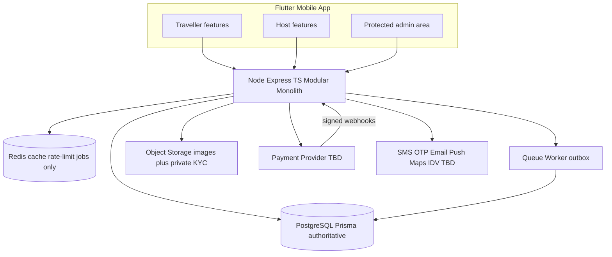
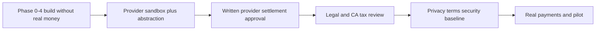

# 00 --- Inspect and Plan (Prompt 0 deliverable)

**Date:** 2026-10-22  
**Source:** Cursor Prompt 0 from `README_BUILD_ORDER.md`  
**Scope:** Architecture summary, unresolved decisions, external dependencies, and milestone plan. No application code.

**Status:** Docs-only repository under `markdown/`. No `apps/api`, `apps/mobile`, or `packages/` yet. Recommended layout in [`../README_BUILD_ORDER.md`](../README_BUILD_ORDER.md) is not applied at repo root.

**Constraint:** Do not invent provider capabilities, settlement timing, tax treatment, or legal conclusions. Unresolved items stay configuration/ADR-gated until humans confirm.

---

## Architecture summary

| Layer | Choice (from docs) |
|-------|-------------------|
| Clients | One Flutter app: traveller, host, **admin inside the same app** — no separate website/admin frontend |
| API | Node.js + Express + TypeScript; REST `/api/v1` (+ `/api/v1/admin` or `/admin/v1`); OpenAPI |
| Data | PostgreSQL authoritative for bookings, inventory, payments, ledger; Prisma migrations; PostGIS only if justified (ADR) |
| Redis / queue | Cache, rate limits, outbox workers — **never** source of truth for money or booking status |
| Money / time | Integer minor units + ISO currency; UTC instants + IANA city/experience timezones; append-only ledger with compensating entries |
| Trust boundary | Server-side RBAC/ownership always; client route guards are UX only |

**Core domain flow:** City/catalogue → request/offer or slot book → snapshot price/commission/cancellation → payment attempt → **webhook-verified** confirm → fulfil/check-in/complete → reviews → payout eligibility (holds for disputes/refunds) → reconciliation.

**Key modules** (from [`02_SYSTEM_ARCHITECTURE.md`](02_SYSTEM_ARCHITECTURE.md)): `auth`, `users`, `hosts`, `cities`, `experiences`, `availability`, `requests`, `offers`, `bookings`, `payments`, `ledger`, `payouts`, `messaging`, `reviews`, `reports`, `admin`.

---

## External dependencies (named; selection TBD)

| Dependency | Role | Gate |
|------------|------|------|
| Payment provider | Checkout, webhooks, refunds, host KYC/settlement | Marketplace eligibility + settlement model in writing before Phase 5 production path |
| Auth / identity | MVP: local email/password + HS256 JWT (no roles in token); refresh rotation in Postgres. OTP, external IdP, recovery, admin step-up TBD | Document `JWT_SECRET` rotation and any future IdP in an ADR before pilot |
| SMS/OTP, email, push | Auth and operational notifications | Vendor + abuse/rate-limit design |
| Object storage | Public listing images; private host documents | Retention + short-lived access |
| Maps / geocoding | Discovery / meeting area (no precise location without purpose) | Optional PostGIS ADR |
| Identity verification vendor | Host KYC documents | Vendor + retention period confirmation |
| Supabase Postgres | Authoritative PostgreSQL. No local Docker database | Connection string in the environment; no service-role key in the repo |
| Hosting / secrets / monitoring | Deploy, backups, logs, alerts | Data residency + ops ADRs before pilot |
| Legal / CA | Entity, GST/TDS, DPDP, e-commerce, RBI applicability | External review — engineering checklist only in [`06_SECURITY_PRIVACY_COMPLIANCE.md`](06_SECURITY_PRIVACY_COMPLIANCE.md) |

---

## Unresolved decisions (human confirmation required)

From [`../PROJECT_CONTEXT.md`](../PROJECT_CONTEXT.md) §“Decisions that require human confirmation” and related docs — **do not silently encode**:

**Product / ops**
- Final app/brand name and domain
- Initial commission % and cancellation rules (15% is modelling example only)
- City activation criteria; pilot cities (Kolkata, Jaipur, Delhi, Kochi are hypotheses)
- Host verification policy by experience category; credential display wording
- Final languages, currency display, international card support
- Dispute windows and payout timing (must match provider + policy)

**Payment provider (Phase 5 / launch blockers)**
- Marketplace eligibility
- Host onboarding/KYC
- Collection, split, and settlement mechanics
- Whether delayed/conditional settlement until completion is supported
- Refund, chargeback, reserve handling
- International cards; tax reports / reconciliation exports
- Contractual and regulatory responsibilities

**Legal / tax (not engineering conclusions)**
- Legal entity and marketplace contractual role
- GST on commission; e-commerce operator / GST TCS if applicable
- Income-tax TDS (e.g. Section 194-O where applicable)
- Invoicing and host tax information
- Consumer Protection (E-Commerce) Rules disclosures
- DPDP Act 2023 / Rules 2025 applicability and phased commencement
- Tourism-guide credentials / local permissions by category
- Insurance/liability for activity types
- Foreign-customer payment / cross-border considerations

**Security / privacy**
- External IdP vs local JWT at scale; OTP/account recovery; privileged
  step-up (MVP: local email/password + HS256 JWT — see `apps/api/.env.example`)
- IDV vendor and document retention/deletion
- Privacy notice, terms, consent/lawful grounds
- Production hosting and data residency
- Moderation purpose, access, retention, appeals (proportionate leakage controls only)

---

## Confirmation gates (payment / legal / tax / security)

- **Before Phase 5 production assumptions:** Provider marketplace + settlement confirmed **or** clearly isolated behind a provider abstraction in **sandbox only** ([`07_IMPLEMENTATION_PLAN.md`](07_IMPLEMENTATION_PLAN.md) Phase 5).
- **Before real payments / launch:** Items in [`05_PAYMENTS_AND_COMMISSION.md`](05_PAYMENTS_AND_COMMISSION.md) §10, [`06_SECURITY_PRIVACY_COMPLIANCE.md`](06_SECURITY_PRIVACY_COMPLIANCE.md) §6, and [`08_TESTING_AND_RELEASE.md`](08_TESTING_AND_RELEASE.md) go/no-go — including forged-callback protection, idempotent ledger, access control, refund/dispute ops capacity.
- **Never assume** the platform may hold customer funds or delay settlement without provider arrangement **and** legal review.

---

## Milestone plan (follow [`07_IMPLEMENTATION_PLAN.md`](07_IMPLEMENTATION_PLAN.md))

One phase per branch/PR; tests + commit before next phase. Align Cursor prompts with [`../README_BUILD_ORDER.md`](../README_BUILD_ORDER.md).

| Phase | Deliver | Exit / hard stops |
|-------|---------|-------------------|
| **0** Decisions & setup | Move docs to root layout; ADR template + decision log; backlog; mark decisions confirmed vs unresolved | Architecture reviewed; payment/legal questions listed |
| **1** Dev foundation | `apps/api` skeleton (`/health`, env validation, logging/request IDs); Flutter skeleton with traveller/host/**admin module scaffold**; lint/CI; `.env.example` with a Supabase Postgres URL; no Docker | CI green; **no** business/payment features |
| **2** Backend foundation | Prisma schema/migrations/seeds (fake data only); validation/errors; JWT auth + dev token seam; RBAC; audit log; test DB | Migrations from empty DB; ownership tests; no secrets in fixtures |
| **3** Cities, hosts, catalogue | City activation; host onboarding/verification; experience CRUD/moderation; slots; search; private doc storage interface | City via data/admin not code; unapproved listings not bookable |
| **4** Requests, offers, bookings | Trip requests; offers + expiry; snapshots; transactional slot holds; booking state machine; notification outbox | No oversell; expired offers blocked; invalid transitions fail; **no fake payment success** |
| **5** Payments & ledger | Provider adapter (sandbox); orders; signed webhooks; idempotent attempts; double-entry ledger; refunds; payouts; reconciliation | Client callback alone cannot confirm; duplicate webhooks safe; **no unapproved fund-holding** |
| **6** Mobile traveller | Discovery → request/offer → checkout → booking/reviews | No hardcoded payment success; loading/error/offline |
| **7** Mobile host | Onboarding, listings, offers, fulfilment, earnings views | Host cannot mutate protected financial/verification fields |
| **8** Admin & trust (Flutter) | Verification, moderation, disputes, refund/payout exceptions, commission versions, city activation, audit/recon screens | Server-enforced permissions; finance approval controls; audit |
| **9** Leakage & hardening | Contact-sharing signals; reports/appeals; rate limits; metrics; retention/deletion | No invasive tracking; false-positive tests; documented policies |
| **10** Pilot & release | Closed pilot; runbooks; backup/restore; incident plan; store/privacy disclosures; readiness report | [`08_TESTING_AND_RELEASE.md`](08_TESTING_AND_RELEASE.md) critical checks; unresolved legal/provider items **block real payments** |

**Cross-phase:** Admin only in `apps/mobile` — never `apps/admin` or a Next.js dashboard.

---

## Tracked work items

- Phase 0: Promote docs to root layout; ADR template + decision log; mark confirmed vs unresolved
- Phase 1: API + Flutter skeletons, CI, env example, health — no business/payment features
- Phase 2: Prisma, RBAC, audit, JWT auth, validation — no payment capture
- Phase 3: Cities, hosts, experiences, availability, search, private docs
- Phase 4: Requests, offers, reservations, booking state machine + concurrency tests
- Phase 5: Provider abstraction/sandbox, webhooks, ledger, refunds, payouts — after provider gate or sandbox-only isolation
- Phases 6–10: Traveller/host mobile, Flutter admin, leakage controls, pilot/release checklist
- Human track: payment-provider written confirmation; legal/tax review; privacy/terms; auth/IDV/hosting ADRs

---

## Immediate next step after this plan

1. Complete **Phase 0** hygiene: copy `markdown/` docs to root paths expected by the build guide; add ADR/decision-log stubs for every unresolved item above.
2. Run **Prompt 1** (Phase 1 foundation only) when ready to implement.
3. Parallel (human, not code): start payment-provider marketplace inquiry and engage counsel/CA using the checklists in docs 05–06 — without coding settlement assumptions.
